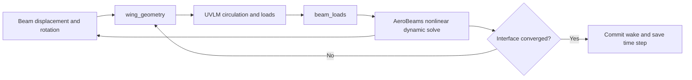

# Reading the Pazy UVLM + AeroBeams analysis

This guide describes the working files inspected on 19 October 2026, including local edits. The main example is a nonlinear, time-domain aeroelastic analysis of the Pazy cantilever wing. UVLM computes the aerodynamic loading and AeroBeams solves the structural dynamics. `PazyWingUVLMCoupling.jl` coordinates the two solvers. A separate runner computes static aeroelastic equilibrium using the same geometry and load transfers.

The [source companion](pazy-uvlm-aerobeams-source.html) contains the complete local source of both packages and the relevant example scripts, with file and function navigation. It includes functions that are available in the packages but are conditional or unused in this particular analysis. The call trees below identify the execution path of the Pazy example; the companion is a source snapshot, not a runtime profiler. Julia's standard library and installed third-party package implementations are outside that snapshot.

For a first reading, follow sections 5–10 to understand what crosses the interface, sections 11–14 to understand how one time step converges, and section 18 for the separate static calculation. Section 19 provides source entry points and a complete call map. The equations explain operations present in the code; numerical values describe the inspected configuration rather than measured simulation results.

The four entry scripts serve different purposes:

| Entry script in `lib/WingPropellerUVLM/examples/pazy_aerobeams_coupled/` | What running it does |
|---|---|
| `run_pazy_wing_uvlm.jl` | Simulates one flight condition in physical time, then plots the response and estimates twist damping. |
| `run_pazy_wing_uvlm_static.jl` | Iterates a fixed-shape aerodynamic calculation and nonlinear structural static balance to seek equilibrium. |
| `run_pazy_stability_sweep.jl` | Repeats dynamic simulations over angles and speeds and estimates flutter onset/offset from response growth. |
| `plot_pazy_flutter_boundaries.jl` | Draws manually supplied boundaries and comparison curves. |

The dynamic runner creates the models and drives both solvers directly. There is no external coupling server: arrays of aerodynamic coordinates and structural nodal loads form the interface inside the same Julia process.

## 1. Start with the physical problem

The wing is clamped at the root. Air flows past it at a prescribed speed, angle of attack, density, and sideslip. The aerodynamic force bends and twists the wing. That deformation changes the aerodynamic surface, which changes the force. The analysis follows this feedback in time.

The structural model retains the nonlinear beam formulation and finite rotations in AeroBeams. Aerodynamics uses a lifting surface represented by vortex rings and a shed wake. There is one explicitly modeled wing surface and no propeller in this example. The package name `WingPropellerUVLM` reflects its wider capabilities.

Conceptually, the coupled equations are

\[
\mathcal R_s(x_{n+1},\dot x_{n+1};f_{a,n+1}+f_{\mathrm{pulse},n+1})=0,
\qquad f_{a,n+1}=\mathcal T_f\,\mathcal A(\mathcal T_x(x_{n+1}),\mathcal H_n).
\]

Here `x` is the structural state, `T_x` maps beam deformation to the aerodynamic grid, `A` is the UVLM solve, `T_f` transfers aerodynamic forces to the beam, and `H_n` is the accepted aerodynamic history: previous geometry, circulation, and wake. These symbols describe the program's operations; they are not variable names in the source.



## 2. The files and their responsibilities

Paths in this table are relative to the repository root. Every file is available in full in the source companion.

| File | Responsibility |
|---|---|
| `lib/WingPropellerUVLM/examples/pazy_aerobeams_coupled/run_pazy_wing_uvlm.jl` | Sets one flight condition, mesh, solver controls, plotting controls; runs the analysis and postprocessing. |
| `.../PazyWingUVLMCoupling.jl` | Constructs both models, transfers geometry and loads, owns the physical time loop and FSI iterations. |
| `.../PazyWingUVLMVisualization.jl` | Plots bending and twist; optionally produces structural and wake GIFs. |
| `.../run_pazy_wing_uvlm_static.jl`, `PazyWingUVLMStatic.jl` | Configure static equilibrium, settle a fresh wake at each fixed shape, and iterate aerodynamic loads with structural static balance. |
| `lib/WingPropellerUVLM/src/WingPropellerUVLM.jl` | Loads the package's backend, kinematics, structural helper and aerodynamic problem definitions; exports its public functions. |
| `lib/WingPropellerUVLM/src/UVLMModel.jl` | Defines aerodynamic model and solver settings. |
| `lib/WingPropellerUVLM/src/OperatingPoint.jl` | Converts speed, angles, and density into a flow operating point. |
| `lib/WingPropellerUVLM/src/UVLMProblem.jl` | Owns accepted aerodynamic state, trial workspace, commit/rollback, and result histories. |
| `lib/WingPropellerUVLM/src/wing_propeller/Kinematics.jl` | Copies accepted panels to `previous_surfaces` for aerodynamic motion velocities. |
| `lib/WingPropellerUVLM/src/backend/*.jl` | Builds panels, solves circulation, calculates induced velocity and forces, and moves the wake. |
| `src/SampleModels.jl` | Provides Pazy geometry, spanwise structural stiffness, and inertia. |
| `src/Beam.jl`, `Element.jl`, `BC.jl`, `Model.jl` | Construct the structural mesh, states, boundary conditions, and global equation indices. |
| `src/Problem.jl` | Initializes and manages AeroBeams dynamic problems and time-discrete history. |
| `src/SystemSolver.jl` | Performs Newton iterations and linear equation solves. |
| `src/Core.jl`, `Utilities.jl` | Evaluate nonlinear beam equations, rotations, residuals, Jacobians, and recovered nodal outputs. |
| `lib/WingPropellerUVLM/studies/src/MovingBlockDamping.jl` | Estimates oscillation frequency and exponential growth or decay from a response. |
| `.../run_pazy_stability_sweep.jl`, `PazyStabilitySweepTools.jl` | Repeat simulations over flight conditions and estimate flutter boundaries. |
| `.../plot_pazy_flutter_boundaries.jl` | Plots manually entered boundaries and comparison data. |

The `.../` prefix in this table means the Pazy example directory in the first row.

## 3. What the captured run file requests

These values are from the run file captured in the source companion, including its uncommitted edits at capture time. They are a concrete example configuration, not library defaults. The live IDE file can change independently; use its values for your next run and the formulas below to calculate the corresponding time and wake scales.

| Setting | Current value | Meaning |
|---|---:|---|
| Airspeed | 45 m/s | Target and actual speed; the current ramp is disabled. |
| Density | 1.225 kg/m³ | Used directly in dimensional aerodynamic forces. |
| Angle of attack | 7 degrees | Converted to radians using `deg2rad`. |
| Sideslip | 0 degrees | Required when using the symmetry option. |
| Chordwise/spanwise panels | 10 / 20 | 200 explicitly solved bound vortex rings. |
| `symmetric_wing` | `true` | Adds aerodynamic image effects across UVLM `y=0`. |
| `time_step_chords` | 0.25 | Sets `U*dt/chord`. |
| `match_wake_panel_chord` | `false` | The time step is independent of chordwise panel length. |
| `wake_length_chords` | 5 | Determines a nominal wake capacity of 20 rows. |
| `core_radius` | 0.001 m | Stored vortex core size; regularization is used where backend finite-core flags enable it. |
| `wake_shedding_fraction` | 0.1 | Offsets the wake shedding line by a fraction of relative travel in one step. |
| Coupling | `:strong` | Repeats aerodynamic and structural solves at each physical time. |
| Maximum FSI iterations | 20 | Limit on geometry/load exchanges per step. |
| FSI relaxation | 0.5 | Averages old trial geometry and newly calculated geometry. |
| Geometry/load tolerances | `1e-4` / `1e-4` | Separate conditions for interface convergence. |
| Maximum Newton iterations | 20 | Limit per structural Newton load step. |
| Newton absolute/relative tolerances | `1e-5` / `1e-5` | Structural convergence controls. |
| Duration | approximately 2 s | Rounded to a whole number of fixed time steps. |
| Pulse start/duration | 1 s / 0.1 s | Relevant when pulse amplitude is nonzero. |
| Pulse amplitude | 0 N | No deliberate tip pulse in the current single-case run. |
| Animations | `false` | GIF generation is skipped. |
| Time histories/twist damping | `true` / `true` | Both plots and a twist growth estimate are requested. |

The helper returns Pazy properties `n_elements=15`, `span=0.549843728 m`, `chord=0.0989 m`, and `spar_fraction=0.44096`. There are 16 beam nodes with the supplied nonuniform spanwise locations.

The time step is calculated, rather than entered independently:

```julia
dt = time_step_chords * chord / airspeed
n_steps = round(Int, duration / dt)
time = collect(0:n_steps) .* dt
```

For the captured inputs, `dt = 0.000549444444444444 s`, there are 3640 physical steps and 3641 samples including `t=0`, and the final time is `1.99997777777778 s`. These are arithmetic consequences of the input values, not results from a new simulation.

The nominal wake-row travel is `U*dt = 0.25*chord`, while a chordwise panel is `0.1*chord`. Setting `match_wake_panel_chord=true` makes both nominal lengths equal. With 20 retained wake rows, the nominal retained wake length is `5*chord = 0.4945 m`, and its nominal retained time is about `0.01098889 s` at this speed. The free wake can deform, so its actual geometry need not have that straight-line length.

## 4. Loading the code and understanding its syntax

The runner includes the coupling file, the visualization file, and the moving-block damping module. The coupling file puts the root AeroBeams project and the local UVLM project on `LOAD_PATH`, then imports `AeroBeams` and imports `WingPropellerUVLM` under the shorter name `UVLM`.

`include` evaluates a file and makes its definitions available. Loading a module also loads definitions for many analyses that this run does not invoke. For example, loading Newmark-beta or rotor functions inside the UVLM package does not select them for Pazy structural dynamics.

This distinction explains the files currently open in the IDE:

| Open file | Role in this Pazy analysis |
|---|---|
| `wing_propeller/Kinematics.jl` | Defines `copy_surfaces_to_previous!`, called by the UVLM problem during initialization and every trial. Its other routines map reduced Bohnisch coordinates or position propellers; the Pazy runner obtains wing geometry from its own `wing_geometry`. |
| `aeroelastic/StructuralTimeIntegration.jl` | Defines matrix-based Newmark and generalized-alpha selection/coupling helpers used by other examples. The Pazy runner advances an AeroBeams `DynamicProblem` through `src/Problem.jl` and `src/Core.jl`. |
| `run_pazy_wing_uvlm.jl` | Sets the dynamic case and calls the coupling function. |
| `plot_pazy_flutter_boundaries.jl` | Reads boundary tuples entered in that script and calls plotting helpers. |
| `pazy-uvlm-aerobeams-walkthrough.md` | Explains the execution path and links to the captured source. |

Useful Julia notation in these files:

| Notation | Meaning here |
|---|---|
| `f(; airspeed, density)` | Passes named keyword arguments using the variables with those names. |
| A function ending in `!` | Conventionally mutates an existing object, such as a problem or its state. |
| `A .= B`, `.*`, `.+` | Elementwise assignment and operations on arrays. |
| `A'` | Conjugate transpose; for these real matrices it is the ordinary transpose. |
| `A \ b` | Solves a linear system; it does not explicitly calculate `inv(A)`. |
| `(; time, dt, ...)` or `(time=time, ...)` | Creates a named tuple, accessed as `result.time`, `result.dt`, and so on. |
| `:strong`, `:loose` | Symbols used to select a program branch. |
| `@unpack`, `@pack!` | AeroBeams macros that read or write fields of an object. |

## 5. Constructing the AeroBeams structural model

The coupling function calls:

```julia
AeroBeams.geometrical_properties_Pazy()
AeroBeams.nodal_positions_Pazy()
AeroBeams.stiffness_matrices_Pazy(
    withSkin=true, sweepStructuralCorrections=false,
    GAy=1e16, GAz=1e16, Λ=0.0)
AeroBeams.inertia_matrices_Pazy(withSkin=true)
```

The stiffness is a spanwise sequence of full 6×6 sectional matrices, including coupling terms. Very large shear stiffnesses strongly suppress shear deformation. The inertia matrices include mass, rotational inertia, and reference-axis offsets. These are sectional beam properties; they are not a preassembled global `M`, `C`, and `K` model.

The beam is created with the specified reference orientation:

```julia
beam = AeroBeams.create_Beam(
    name="Pazy wing", length=span, nElements=n_elements,
    normalizedNodalPositions=beam_nodes, S=stiffness, I=inertia,
    rotationParametrization="E231", p0=[-pi/2; 0.0; 0.0],
    aeroSurface=nothing)
```

`p0` specifies the initial beam orientation using the selected Euler convention. The subsequent deformation rotations use AeroBeams' Wiener–Milenković rotation parameters. The freestream angle of attack is applied in UVLM; the code does not also add the flight incidence to this reference beam orientation.

`aeroSurface=nothing` is central: the structural elements have no AeroBeams aerodynamic surface or strip-theory states during the solve. UVLM supplies their external aerodynamic loading through nodal boundary conditions. The calls to AeroBeams aerodynamic helper functions inside its general solver return early for these elements.

The root clamp prescribes all three translations and all three rotations as zero. One further boundary condition is created at each beam node, with six force/moment components:

```julia
types = ["F1A", "F2A", "F3A", "M1A", "M2A", "M3A"]
```

These components are resolved in the AeroBeams reference basis A. They remain fixed during an individual structural Newton solve and are refreshed during the outer FSI iterations. Gravity is set to zero, and the reference frame has zero prescribed translational velocity. The relative airflow is supplied by UVLM's freestream.

`create_Model` assembles connectivity, special nodes, boundary conditions, and equation indices. A structural element carries the mixed state vectors `u`, `p`, `F`, `M`, `V`, and `Ω`: displacement, finite rotation parameters, sectional force, sectional moment, linear velocity, and angular velocity. Nodal variables and reactions are also assembled at special nodes. Thus this code solves AeroBeams' mixed beam equations; it does not first reduce the structure to a few vibration modes.

Then the code builds a Newton solver and a `DynamicProblem`, precomputes distributed-load storage, initializes consistent structural states using `solve_initial_dynamic!`, and saves the initial state. Initial nodal aerodynamic loads are zero and the aerodynamic wake starts empty. This is a startup transient, rather than an initialization from a previously converged coupled aerodynamic equilibrium.

`solve_initial_dynamic!` first works on a copy of the structural problem, imposes the specified initial conditions, uses an infinite time step for an initial steady solve, and copies consistent states back. It then calls `update_initial_velocities!`, which uses a small auxiliary structural step, and the guarded `update_initial_aero_states!`. No UVLM trial is called during that process. Consequently, the word “initial” here refers to structural initialization; the first coupled aerodynamic loads arrive in the physical time loop.

## 6. Coordinate systems and transfer from beam to UVLM

The coordinate conversion is explicitly defined:

```julia
const A_TO_UVLM = [0.0 -1.0 0.0;
                   0.0  0.0 1.0;
                  -1.0  0.0 0.0]
```

| UVLM axis | Corresponding AeroBeams A direction |
|---|---|
| `+x`, downstream | `-y_A` |
| `+y`, along the modeled span | `+z_A` |
| `+z`, upward | `-x_A` |

The forward mapping uses `A_TO_UVLM`; the inverse mapping uses its transpose. Aerodynamic force histories and structural force histories therefore use different axes, even though both are in SI units.

The aerodynamic grid has shape `(3, nc+1, ns+1)`, currently `(3,11,21)`. The beam has 16 nodes. A weight matrix `W` of shape `(21,16)` linearly interpolates between the two neighboring beam stations for each aerodynamic span station. Each row has at most two nonzero weights and sums to one.

`wing_geometry` first constructs chord lines at the beam nodes. For node `a`, its current centerline position is its reference position plus recovered displacement. Its chord direction is

\[
d_a=R(p_a)R_{0,a}\begin{bmatrix}0\\1\\0\end{bmatrix}.
\]

The aerodynamic physical grid at chord fraction `ξ` is then

\[
X_{kj}=Q\sum_a W_{ja}\left[r_a+(s-\xi_k)c\,d_a\right],
\]

where `Q=A_TO_UVLM`, `s=spar_fraction`, and `ξ_k=(k-1)/nc`. The root position and rotation are enforced exactly from the clamp when generating the aerodynamic grid. This avoids a small recovered root displacement producing nearly coincident image vortices at the symmetry plane.

The routine also builds moment arms at the vortex vertices. Interior vortex rows are shifted a quarter of one panel aft of physical grid rows; the final row is at the actual trailing edge. Consequently, the arm used for force transfer uses

```julia
vortex_fraction = k <= chordwise_panels ?
    (k-1+0.25) / chordwise_panels : 1.0
```

The backend's `grid_to_surface_panels` uses the same geometry: quarter-panel vortex rows, a control point at 75% chord within a panel and halfway across its span, and an exactly trailing-edge final vortex row.

## 7. The aerodynamic problem and its state

`create_UVLMModel` stores reference grids, symmetry flags, and interaction groups. `create_UVLMSolver` stores core size, shedding offset, and the interaction flag. `create_OperatingPoint` stores speed, density, and angles. In this example it produces zero body angular rates and no rotor motion.

The freestream in UVLM body axes is

\[
U_\infty=U[\cos\alpha\cos\beta,\;-\sin\beta,\;\sin\alpha\cos\beta]^T.
\]

The aerodynamic reference uses `S=span*chord`, `c=chord`, `b=span`, and a moment reference at the origin. Its area is the explicitly modeled semispan wing area, about `0.0543795447 m²`. Image vortices affect the flow when symmetry is enabled, but returned dimensional loads are for the explicitly modeled surface.

`create_UVLMDynamicProblem` allocates a backend `System`, initializes its grid, sets circulation to zero and active wake length to zero, and makes a private workspace copy. Important fields are:

| Field | What it holds |
|---|---|
| `state.system` | Accepted aerodynamic state at physical time `n`. |
| `workspace.system` | A candidate state for the same next physical time. |
| `Γ` | Bound circulation, one value per vortex panel; currently 200 values. |
| `dΓdt` | `(Γ_trial-Γ_accepted)/dt`, with physical time in seconds. |
| `AIC` | Dense aerodynamic influence matrix; currently 200×200. |
| `w` | Right-hand side enforcing no normal flow through the lifting surface. |
| `surfaces`, `previous_surfaces` | Current and accepted panel geometry. |
| `wakes`, `nwake` | Allocated wake panels and their active row counts. |
| `Vcp`, `Vh`, `Vv`, `Vte` | Relative-flow contributions caused by wing movement. |
| `span_seg_forces`, `chord_seg_forces`, `unsteady_forces` | Dimensional force contributions used for transfer. |

The `System` docstring calls `dΓdt` a derivative with respect to nondimensional time, but this execution path explicitly divides by the supplied SI time step. The implementation governs the interpretation here. Similarly, the `imperial_*` function names identify a force formulation/convention; they do not indicate British Imperial units.

## 8. One physical time step, in execution order

The outer loop starts at the second time sample and advances to the end of `time`.

1. `AeroBeams.update_time_variables!` selects the new time interval. `update_basis_A_orientation!` updates the reference frame orientation; the prescribed frame is stationary in this example.
2. A cubic smoothstep optionally ramps the speed. With the captured inputs the speed is 45 m/s throughout. Both `operatingPoint` and the accepted backend reference speed are refreshed, so circulation and dimensional forces use the current flow.
3. The first interface guess extrapolates the last two accepted grids and moment arms: `grid_guess = 2*grid-previous_grid`. At the first step these two grids are identical. Later this predicts wing movement and supplies a nonzero velocity estimate to the first UVLM trial.
4. The optional tip force is calculated at this physical time. It is held constant during all FSI iterations for this step.
5. `AeroBeams.get_equivalent_states_rates!` stores the previous structural state and its rates once. Repeated FSI solves must refer to this same physical history.
6. `UVLM.begin_time_step!` opens an aerodynamic trial interval. The accepted aerodynamic state stays at time `n` while candidate circulation and forces are evaluated.
7. The selected coupling branch computes a candidate solution; strong coupling is detailed below.
8. After acceptance, aerodynamic nodal loads are stored, accepted geometry becomes the history for the next predictor, and `UVLM.commit_time_step!` convects/sheds the wake once.
9. Structural states, tip bending, tip twist, coupling iteration count and residuals, and optional animation snapshots are saved.

The pulse formula is

```julia
phase = (time[i] - settling_time) / perturbation_duration
tip_force = 0 < phase < 1 ?
    perturbation_amplitude * sin(2pi*phase) * sinpi(phase)^2 : 0.0
```

It is a smooth, signed tip-force pulse with a positive and a negative part, applied to component `F1A` at the last beam node. `perturbation_amplitude` is its multiplier, not exactly its maximum attained magnitude. `settling_time` controls pulse timing and limits the optional ramp duration; it does not pause the solver, enforce equilibrium, or exclude startup data from the damping fit. The current zero multiplier disables the pulse, while freestream/wake startup can still excite a transient.

The following table identifies which values can change while solving the same physical interval:

| Quantity | During FSI iterations at `n+1` | At successful acceptance |
|---|---|---|
| AeroBeams equivalent rates | Fixed values formed from the accepted state at `n`. | Recomputed from the new accepted structural state at the beginning of the next interval. |
| AeroBeams `x`, element and nodal states | Updated by structural Newton solves; the latest iterate supplies the next solve's starting state. | Saved as the solution at `n+1`. |
| UVLM `state.system` geometry, circulation and wake | Remain the accepted physical history at `n`; the flow reference has already been refreshed for this interval. | Replaced by the committed trial system. |
| UVLM `workspace.system` | Recreated from `state.system` on every trial, then filled with trial geometry, circulation and forces. | Its last successful trial supplies the system to commit. |
| `grid_guess`, `offsets_guess` | Relaxed toward the structural candidate. | Candidate geometry becomes the next accepted interface geometry. |
| Nodal force/moment BCs | Replaced before each structural solve and fixed throughout that solve. | Refreshed to the final accepted aerodynamic loads plus the pulse. |
| Wake time and active row count | Stay at `n`; trial wake attachment is updated privately. | Advance once in `commit_time_step!`. |

An FSI iteration is therefore another solution attempt for `n+1`. It does not represent another physical time increment. The geometry extrapolation predicts coordinates; AeroBeams still calculates its state rates from the trapezoidal relation in section 12.

## 9. What a UVLM trial calculates

Every call to `evaluate_trial!` starts with a deep copy of the same accepted `state.system`. It copies accepted panels into `previous_surfaces`, installs the guessed new grid, recreates surface panels, then calls `propagate_system!` with `advance_wake=false` and `derivatives=false`.

The important calculation sequence is:

```text
evaluate_trial!
  copy_surfaces_to_previous!
  apply_trial_geometry!
    grid_to_surface_panels
  propagate_system!
    get_surface_velocities!
    update_wake_shedding_locations!
    influence_coefficients!
    update_trailing_edge_coefficients!
    normal_velocity!
    circulation!
    near_field_forces!
  dimensional_loads
    imperial_nodal_forces
    imperial_nodal_positions
```

`get_surface_velocities!` stores `(old_position-new_position)/dt`. This is the negative wing velocity, because it is added to the fluid velocity to form the flow relative to the moving wing. It is evaluated at control points, force segments, and trailing-edge vertices.

Each bound vortex ring induces velocity at every receiving control point. `influence_coefficients!` projects these velocities onto the receiving panel normal to form the AIC matrix, including symmetry images and the current shedding geometry. It uses vortex-segment/ring Biot–Savart helpers in `induced.jl`. The matrix is rebuilt for trial moving geometry. `normal_velocity!` forms the opposite normal component of freestream, wing-motion contribution, and existing wake-induced velocity:

\[
w_i=-n_i\cdot(U_\infty-v_{\mathrm{wing},i}+u_{\mathrm{wake},i}).
\]

The actual routines also accommodate body rotation and additional prescribed velocity; both are zero/absent here. Circulation follows from

\[
AIC(X^{(k)})\Gamma^{(k)}=w(X^{(k)},\mathcal H_n),
\qquad \dot\Gamma^{(k)}=(\Gamma^{(k)}-\Gamma_n)/\Delta t.
\]

`circulation!` uses an LU factorization and a linear solve. This is a linear aerodynamic solve for a particular trial geometry, repeated inside the nonlinear coupled problem.

`near_field_forces!` calculates forces on spanwise and chordwise vortex segments using circulation jumps between neighboring rings:

```julia
imperial_segment_force(velocity, r1, r2, delta_gamma, rho) =
    rho * delta_gamma * cross(velocity, r2 - r1)

imperial_unsteady_panel_force(panel, gamma_dot, rho) =
    -rho * imperial_panel_area(panel) * normal(panel) * gamma_dot
```

Local segment velocity includes the freestream, wing-motion contribution, bound-vortex induced velocity and wake-induced velocity, with self-segment exclusion handled by the backend. The routine converts the backend ring sign convention using `_to_imperial_circulation`. Therefore the signs in these expressions must be read together with that conversion and the ring/segment orientations.

`imperial_nodal_forces` assigns half of each segment force to each endpoint and one quarter of each unsteady panel force to each corner. The output is a matrix of dimensional forces at the `(nc+1)×(ns+1)` vortex vertices, currently 11×21. `imperial_nodal_positions` returns matching vortex-vertex positions. There is no direct viscous profile-drag or dynamic-stall model selected in this path; the aerodynamic force calculation is the attached lifting-surface UVLM calculation in these functions.

A trial does update its private wake attachment geometry near the trailing edge. It does not convect the accepted wake forward or add an accepted wake row. That distinction allows all FSI trials to use one consistent physical history.

## 10. Transfer from aerodynamic forces to beam loads

`beam_loads` rotates every vertex force back to AeroBeams axes and distributes it to neighboring beam nodes using the same interpolation weights as `wing_geometry`:

```julia
force = A_TO_UVLM' * forces[k, j]
for node in axes(weights, 2)
    weight = weights[j, node]
    nodal_loads[1:3, node] .+= weight .* force
    nodal_loads[4:6, node] .+=
        weight .* cross(vortex_offsets[:, k, node], force)
end
```

The returned `nodal_loads` has shape `(6,16)`. The first three rows are forces in N; the last three are moments in N·m. The moment comes from applying a vertex force away from the elastic axis. A chordwise distributed aerodynamic load can therefore twist the beam even though UVLM initially returns forces rather than a separate sectional pitching-moment input.

The arm is each beam node's own rotated chord offset. This is the transpose of the adopted motion interpolation in the virtual-work sense: the work done by aerodynamic vertex forces agrees with the work done by the transferred beam forces/moments for variations of that mapping. Using the interpolated aerodynamic vertex position minus each beam-node position would introduce extra spanwise moment arms inconsistent with the motion interpolation.

`apply_pazy_nodal_loads!` writes the six numeric components into `problem.model.BCs[node+1].values` and calls `AeroBeams.update_BC_data!` to refresh cached BC values. It deliberately accesses the active problem model because AeroBeams may replace its model with a saved copy during a Newton retry.

For a small illustrative calculation, suppose one UVLM vertex carries upward force `[0,0,4] N`. The axis conversion gives `[-4,0,0] N` in AeroBeams A axes. If its two contributing beam stations have weights `0.75` and `0.25`, they receive `F1A=-3 N` and `F1A=-1 N`. If both stations' vortex offsets are `[0,0.02,0] m`, the cross products also give `M3A=0.06 N·m` and `M3A=0.02 N·m`. Thus one upward aerodynamic force produces both bending loading and a torsional moment about the beam axis. These example values illustrate the transfer and are not simulation output.

The reason for using the same weights in both directions can be seen directly from a virtual displacement. Let `a` label a beam station, `v` a vortex vertex, `r_av` its chord offset at station `a`, and `f_v^A=Q' f_v`. The adopted geometry mapping gives

\[
\delta X_v=Q\sum_a W_{va}
  \left(\delta u_a+\delta\theta_a\times r_{av}\right).
\]

Consequently,

\[
\sum_v f_v\cdot\delta X_v
=\sum_a\left[
  \left(\sum_v W_{va}f_v^A\right)\cdot\delta u_a+
  \left(\sum_v W_{va}(r_{av}\times f_v^A)\right)\cdot\delta\theta_a
\right].
\]

The two bracketed sums are exactly the force and moment computed by `beam_loads`. Here `δθ` is a physical infinitesimal rotation, whereas AeroBeams stores finite rotations as Wiener–Milenković parameters and handles their kinematic relations internally. Because each weight row sums to one, the transfer also preserves the sum of applied forces after axis conversion. Root-node contributions remain in the transferred load array; the clamp supplies the corresponding reactions.

## 11. What AeroBeams solves under those loads

The current example calls `AeroBeams.solve_time_step!(structure)`. Because `getLinearSolution` retains its default `false`, this dispatches to `solve_NewtonRaphson!`. The coupling owns the outer physical time loop and explicitly invokes AeroBeams' time-step operations; it does not call the whole standalone AeroBeams time march in parallel with its own loop.

The key call tree is:

```text
solve_time_step!
  solve_NewtonRaphson!
    assemble_system_arrays!
      element_states!                     # unpack the current global state
      element_arrays!                     # for each structural element
        element_velocities_basis_b!
        element_states_rates!
        element_rotation_variables!
        element_distributed_loads!
        element_strains!
        element_momenta!
        element_momenta_rates!
        element_residual!
        distributed_loads_derivatives_rotation_parameters!
        aero_derivatives!                 # returns early without element aero
        element_jacobian!
      special_node_states!
      special_node_arrays!
        special_node_residual!
        special_node_follower_loads_derivatives_rotation_parameters!
        special_node_jacobian!
    solve_linear_system!
    update_states!                        # after a converged load step
      element_states!, element_states_rates!, rotation/load helpers
      element_strains!, element_momenta!, element_momenta_rates!
      element_nodal_states!
```

Some helpers perform no physical contribution for this configuration: gravity is zero, distributed external loads are absent, and the elements have no built-in aerodynamic surface. Nodal UVLM loads enter through the special-node/boundary-condition equations. The full implementations and their further rotation and algebra helpers are in the source companion.

The beam constitutive and momentum relations are represented by

\[
\begin{bmatrix}\gamma\\\kappa\end{bmatrix}
=S^{-1}\begin{bmatrix}F\\M\end{bmatrix},
\quad
\begin{bmatrix}P\\H\end{bmatrix}
=I\begin{bmatrix}V\\\Omega\end{bmatrix},
\quad
\begin{bmatrix}\dot P\\\dot H\end{bmatrix}
=I\begin{bmatrix}\dot V\\\dot\Omega\end{bmatrix}.
\]

The structural residual combines force/moment equilibrium, displacement/rotation compatibility, and velocity/displacement kinematics. Finite rotations, moment-arm changes, and rotational momentum terms make the equations nonlinear. `element_residual!` includes terms involving `RdotR0*P + RR0*Pdot` and `RdotR0*H + RR0*Hdot` in transient equilibrium.

Newton solves the time-discrete residual using

```julia
Δx .= -jacobian \ residual
x[1:systemOrder] .+= Δx[1:systemOrder]
```

The actual structural convergence test accepts either `norm(residual) < absoluteTolerance` **or** `norm(Δx)/norm(x) < relativeTolerance`. These norms are distinct from the outer interface geometry/load residuals. Newton can retry using smaller load-factor increments, restoring saved state/model copies. This changes the nonlinear solution path within the same physical step; the coupled example has a fixed physical `dt` and does not automatically reduce it after an FSI failure.

After a structural solve, `element_nodal_states!` recovers nodal displacements and rotations from the mixed elemental solution. `wing_geometry` uses those recovered outputs for the next UVLM geometry.

## 12. The exact structural time integration

The most precise description of the current AeroBeams implementation is an implicit trapezoidal update applied to its first-order structural state/rate relations. Before the FSI loop it saves, for each applicable state `q`,

```julia
qdotEquiv = qdot_n + 2/dt * q_n
```

Inside structural residual evaluation it calculates

```julia
qdot_np1 = 2/dt * q_np1 - qdotEquiv
```

The actual functions apply this to `u`, `p`, `V`, `Ω`, and any built-in aerodynamic states `χ` when present. There are no `χ` states in these aerodynamic-free structural elements. Rearranging gives

\[
q_{n+1}=q_n+\frac{\Delta t}{2}(\dot q_n+\dot q_{n+1}).
\]

For ordinary second-order displacement/velocity dynamics, trapezoidal integration gives the Newmark average-acceleration form with `γ=1/2` and `β=1/4`. AeroBeams implements the state/rate form above, including nonlinear rotation kinematics; this is the more accurate description than assuming it directly calls a displacement-based Newmark-beta kernel.

The separate UVLM package routines `newmark_beta_corrector`, `generalized_alpha_corrector`, `structural_predictor`, and `partitioned_aeroelastic_step` support other structural coupling analyses. This Pazy runner does not call them. In particular, their default dissipative Newmark values `γ=0.55`, `β=0.275625` do not describe the time discretization selected by this Pazy AeroBeams example.

No independent structural damping matrix or structural damping coefficient is selected by this runner. A damping estimate from the response describes the coupled transient under the numerical and physical settings used, rather than a material damping parameter entered here.

## 13. Strong coupling: three nested loops

The default run has three separate loop levels: physical time steps, FSI geometry/load exchanges at one time, and Newton iterations inside each structural solve. There can also be Newton load-factor retries. A Newton print such as `i: ..., σ: ..., ϵ_abs: ..., ϵ_rel: ...` describes the structural solve. A progress line containing `FSI`, `r_x`, and `r_F` describes the outer interface solve.

At FSI iteration `k`:

1. UVLM computes loads on guessed grid `X^(k)` from accepted aerodynamic history at `n`.
2. `beam_loads` transfers those loads; the tip pulse is added; BC caches are updated.
3. AeroBeams solves the full nonlinear structural state at `n+1` for those fixed applied loads.
4. `wing_geometry` obtains structural candidate grid `X_s^(k)` and its vortex moment arms.
5. Geometry error and the change in aerodynamic nodal loads are evaluated.
6. If those satisfy tolerances, one additional UVLM trial is evaluated on `X_s^(k)` itself and its load change is checked before acceptance.
7. Otherwise the trial grid and arms are relaxed and another FSI exchange begins.

The geometry residual is exactly

\[
r_x=\frac{\max_{component,k,j}|X_{s,kj}^{(k)}-X_{kj}^{(k)}|}{c}.
\]

For `1e-4` tolerance and this chord, the allowed maximum component discrepancy is `9.89e-6 m`. This measures agreement between the current trial grid and structural candidate, rather than the physical displacement accumulated during a time step.

`interface_load_residual` uses separate force and moment scales:

\[
s_F=\max(\|F_k\|_\infty,\|F_{k-1}\|_\infty,1\,\mathrm N),
\quad s_M=\max(\|M_k\|_\infty,\|M_{k-1}\|_\infty,s_Fc),
\]
\[
r_F=\max\left(\frac{\|F_k-F_{k-1}\|_\infty}{s_F},
\frac{\|M_k-M_{k-1}\|_\infty}{s_M}\right).
\]

The first load residual is infinity, so strong coupling needs at least two trials. Both interface criteria must pass. The pulse is excluded from this load residual because it is prescribed and identical for every FSI trial at that time.

Relaxation is applied to geometry and moment arms:

```julia
grid_guess .= (1 - coupling_relaxation) .* grid_guess .+
    coupling_relaxation .* candidate_grid
offsets_guess .= (1 - coupling_relaxation) .* offsets_guess .+
    coupling_relaxation .* candidate_offsets
```

With relaxation 0.5, each new guess is halfway between the previous guess and the structural candidate. There is no assembled coupled aeroelastic Jacobian in this example; this is a partitioned fixed-point iteration around the two separate solvers.

The final aerodynamic check makes the committed aerodynamic geometry match the structural candidate. The structural state was solved under the preceding trial loads; the code accepts the refreshed loads when their difference passes the same load tolerance. It does not perform another structural solve after that final aerodynamic check. The coupled consistency is therefore controlled by the tolerances rather than exact equality of the final two solves.

If structural convergence or FSI convergence fails, the code raises an error. The `catch` restores the aerodynamic accepted state via `rollback_time_step!` and rethrows. It does not implement a structural rollback and adaptive restart of that failed physical step.

With `coupling_scheme=:loose`, steps 1–4 occur only once on extrapolated geometry. The structural candidate is accepted without interface convergence, load residual is recorded as `NaN`, and the aerodynamic trial remains based on its predicted geometry. The explicit interface approximation can consequently differ from the strong-coupling result even with the same structural solver.

The following condensed pseudocode shows the nesting. It is a reading aid; the real loop also updates speed, applies the pulse, checks failures and saves histories.

```text
for each physical interval n -> n+1
    form equivalent structural rates from accepted n, once
    open the UVLM interval
    predict geometry and moment arms
    for each FSI iteration k
        recreate UVLM trial from accepted n
        solve circulation and loads on guessed n+1 geometry
        transfer forces and moments to structural BCs
        solve the nonlinear structural step at n+1
            Newton: assemble beam residual/Jacobian and solve corrections
        recover the structural candidate geometry
        check geometry change and aerodynamic load change
        if both pass
            evaluate UVLM on the structural candidate itself
            if its load change also passes: accept and leave FSI loop
        relax guessed geometry and moment arms
    commit the last UVLM trial and advance its wake once
    save structural and aerodynamic outputs
```

Changing `coupling_relaxation` changes the progression of trial interface geometry, while changing `newton_*` changes each structural solve. These are separate controls. `time_step_chords` changes the physical discretization; changing `maximum_wake_rows` changes how much aerodynamic wake history is retained. Converged FSI residuals alone do not establish independence from the physical time step, meshes or retained wake length.

## 14. Wake convection and acceptance

`commit_time_step!` takes the last successful aerodynamic trial and calls `advance_wake!` exactly once. Its main calls are

```text
commit_time_step!
  advance_wake!
    get_wake_velocities!
    shed_wake!
      translate_wake!
        translate_wake
      rowshift!
  commit_wake_rows!
  save_time_step!                 # when aerodynamic tracking is enabled
```

Existing wake vertices move using their computed flow velocities. The backend includes bound- and wake-induced velocities when moving existing downstream wake vertices. The initial shedding-line velocity uses the prescribed flow and trailing-edge motion. Existing panel vertices use a `position += velocity*dt` update; `translate_wake` also adjusts circulation by its implemented old/new filament-perimeter ratio for vortex stretching. A new wake row takes the current trailing-edge bound circulation. `rowshift!` makes it the newest row; the oldest row is replaced when capacity is reached.

The accepted state then adopts this system, its time advances, and the step index increments. FSI iteration count does not increase the number of physical wake rows. `aerodynamic_interaction` controls influences between differently identified surface groups; with one group it does not turn off the wing's own induced velocities or its free-wake development.

## 15. Results, plots, and animation

`run_pazy_wing_uvlm` returns a named tuple with the following principal fields:

| Result field | Interpretation |
|---|---|
| `structural_problem` | AeroBeams model, final state, saved elemental/nodal states and state rates. |
| `aerodynamic_problem` | Accepted UVLM state, private workspace, reference settings and optional histories. |
| `time`, `dt`, `time_step_chords` | Physical sampling. |
| `airspeed_history` | Actual speed, including a ramp if enabled. |
| `tip_out_of_plane`, `tip_bending_displacement` | Same bending history, in m; `-u_n2[1]` in basis A. |
| `tip_twist_degrees` | Twist computed from a rotated local chord direction, in degrees. |
| `aerodynamic_nodal_load_history` | Shape `(6,16,nt)`; aerodynamic loads in AeroBeams A axes, excluding the prescribed pulse. |
| `coupling_iterations` | Number of FSI exchanges per physical step; initial sample is zero. |
| `coupling_geometry_residual`, `coupling_load_residual` | Final interface residual histories. |
| `aerodynamic_surface_history`, `wake_history`, `animation_time` | Sampled geometry for visualization. |

Twist is calculated by `wingtip_twist_degrees`: rotate the local chord `[0,1,0]` using the tip's local deformation rotation, then take `asind` of its out-of-plane component. It is a finite-rotation chord-angle measure, not simply one component of the rotation-parameter vector.

When `save_uvlm_history=true`, `aerodynamic_problem.results` stores `savedTimeVector`, bound `circulationOverTime`, and summed dimensional `forceOverTime` and `momentOverTime` in UVLM axes. Moment is calculated about the chosen reference point using the matching force-application positions. The Pazy wrapper saves the initial structural state; aerodynamic result history saving begins on accepted aerodynamic steps. The two history arrays therefore need not have identical initial sampling.

`save_tip_time_histories` creates the bending/twist PNG. `moving_block_damping` creates a separate diagnostic plot. `filename_number` creates labels such as `aoa5_V50p5`; current output names use that suffix.

Optional `save_animations` calls `save_structural_animation` and `save_wake_animation`. Structural visualization temporarily attaches NACA0018 airfoil geometry to draw the wing using `AeroBeams.plot_dynamic_deformation`, then restores the model. This happens after the solution and supplies display geometry. It does not add an extra aerodynamic calculation to the completed dynamics. Wake visualization draws saved vortex vertices and wake panels with synchronized frame times.

One current implementation detail affects storage: the single-case runner sets `generate_animations=false` but does not pass `save_animation_history=false` to the coupling function. The helper's default still collects animation snapshots. The flag skips GIF production, while snapshot collection remains enabled. The sweep explicitly disables snapshot collection.

## 16. Moving-block frequency and damping

The single-case runner passes the complete tip-twist record to `moving_block_damping`. It finds positive local peaks above 1% of the maximum absolute signal and trims from the first selected peak to the last selected peak. It adjusts the initial 512-sample block size by powers of two to occupy 25–50% of the selected record.

For every overlapping block, shifted one sample at a time, it subtracts the block mean, performs an FFT, discards the zero-frequency bin, and records the dominant spectral amplitude and its frequency. It fits

\[
\log A(t_{\mathrm{block}})\simeq a+\lambda t_{\mathrm{block}},
\qquad f=\operatorname{median}(f_{\mathrm{block}}),\qquad \omega=2\pi f.
\]

It reports the growth/decay rate `λ` in 1/s, frequency `f` in Hz, and the damping ratio

\[
\zeta[\%]=-100\frac{\lambda}{\sqrt{\lambda^2+\omega^2}}.
\]

Negative `λ` gives positive damping and a decaying oscillation; positive `λ` gives negative damping and a growing oscillation. This interpretation assumes the fitted segment represents an identifiable approximately exponential oscillation. Startup changes, several competing frequencies, amplitude saturation, or a changing mean shape can make the estimate less representative of a single linear mode. Frequency is estimated from FFT bins; block length controls its resolution.

The standalone plotting function requires enough qualifying peaks and can throw if they are absent. The sweep uses the related `moving_block_metrics` function, which returns structured availability, R², analyzed segment, FFT spacing, and other diagnostics. Neither Pazy runner automatically removes all data before the prescribed pulse: a desired post-pulse fit requires selecting a fitting interval using the appropriate metrics options or trimming the record before calling it.

## 17. The stability sweep and flutter-boundary procedure

`run_pazy_stability_sweep.jl` has its own settings. Editing the single-case runner does not change its settings. In the inspected file it requests angles `[0,1,3,5,7]` degrees and speeds `30:10:90` m/s, giving 35 cases, each initialized afresh. It uses a nonzero 10 N pulse multiplier starting at 0.2 s, the same 2 s duration and nominal mesh/time/wake sizes, and up to 30 Newton and FSI iterations.

For each combination the procedure is:

1. Run `run_pazy_wing_uvlm`, or read a saved `response.csv` when `run_simulations=false`.
2. Save time, airspeed, tip bending, and tip twist in a case directory.
3. Select twist or bending using `response_to_fit`, currently `:twist`.
4. Check that the actual recorded speed is constant and matches the target speed.
5. Call `moving_block_metrics` and record growth, damping, frequency and R².
6. Classify a fit as `growing` or `decaying` only if it is available, has R² at least 0.90 and `abs(λ)>0.05 1/s`. Otherwise classify it as `unresolved`. A caught simulation/processing error is classified as `failed` and written to `failure.txt`.
7. Save response/fit plots and update `damping_summary.csv`.

`sweep_crossings` estimates a boundary only between adjacent finite growth rates of opposite sign:

\[
U_* = U_1-\lambda_1\frac{U_2-U_1}{\lambda_2-\lambda_1}.
\]

A negative-to-positive crossing is an onset; positive-to-negative is an offset/restabilization. Strict results are written to `uvlm_boundary.csv`. Opposite-sign resolved results separated only by unresolved cases are reported as intervals in `uvlm_boundary_brackets.csv`, rather than interpolating through failed data.

The sweep also creates `uvlm_boundary_updated.csv` using a more provisional procedure. It can use a positive-growth fit that did not meet the strict quality threshold, brackets it with decaying cases, and marks the result as provisional. At angles in `midpoint_bracket_angles_deg`, currently `[4,6]`, it uses a bracket midpoint for provisional saturated responses. Those two angles are not in the currently selected sweep angle list, so that special branch has no effect in the current 35-case configuration. The final comparison plot receives these estimated/provisional boundaries, whereas the strict CSV remains a separate result.

`plot_sweep_comparison` shades the region between paired onset/offset estimates and overlays experimental points and literature curves from repository data. `sweep_aerobeams_boundary` reads cached tracked third-mode damping values from `test/newTestDataGenerators/PazyWingFlutterPitchRange/damps*.txt`; it does not launch a new AeroBeams eigenanalysis. These eigenvalue and literature curves are comparison data, separate from the time-domain UVLM simulations.

`plot_pazy_flutter_boundaries.jl` is a manual plotting route. It uses the `pazy_boundaries` tuples in that file and asks the user to copy chosen values from the spreadsheet. It does not parse the `.xlsx` file. All the currently inspected tuples have `NaN` boundaries, so they supply no UVLM flutter region until values are entered.

The static calculation described next has a separate entry script and does not initialize the current dynamic runner.

## 18. Static aeroelastic equilibrium, step by step

`run_pazy_wing_uvlm_static.jl` includes `PazyWingUVLMStatic.jl`, which conditionally includes `PazyWingUVLMCoupling.jl` to reuse `A_TO_UVLM`, `wing_geometry`, `beam_loads`, `apply_pazy_nodal_loads!`, `interface_load_residual`, and `wingtip_twist_degrees`. The static driver itself is `run_pazy_wing_uvlm_static`.

It creates the same skin-on, 15-element Pazy beam with a clamp and six-component nodal load BCs. It then creates an AeroBeams `SteadyProblem` and solves the unloaded structural state. Its unknowns satisfy static beam balance; structural acceleration and the dynamic trapezoidal update are absent from this path.

The inspected static runner uses its own settings: `U=55 m/s`, `α=2°`, a `4×15` aerodynamic mesh, 40 retained wake rows, and `dt=c/(4U)`. It allows up to 100 static iterations with load relaxation `0.3`. These settings are independent of the dynamic runner's `45 m/s`, `7°` case.

For static iteration `k`, the code executes the following sequence:

1. Read the current equilibrated structural model and construct its aerodynamic grid and vortex offsets using `wing_geometry`.
2. Call `settle_static_uvlm` on that grid. This creates a fresh `UVLMDynamicProblem` with zero initial circulation and an empty wake.
3. Hold that grid fixed for all aerodynamic time steps. At each step, call `begin_time_step!`, `evaluate_trial!`, `beam_loads`, and `commit_time_step!`. The wake develops while the wing stays motionless.
4. Test the aerodynamic force and circulation histories over a whole trailing window. Continue until they settle or the allowed aerodynamic time expires.
5. Compare the settled aerodynamic nodal loads with `applied_loads`, which are the loads under which the current beam shape was equilibrated. Also check the grid change caused by the preceding structural update.
6. If the wake settled and both static interface criteria pass for the required number of consecutive outer iterations, accept the current beam and wake.
7. Otherwise relax the applied loads toward the newly calculated loads, refresh the BCs, call `AeroBeams.solve!(structure)` for static Newton balance, measure the resulting grid change, and repeat.

Here relaxation acts on loads:

```julia
applied_loads .= (1-static_relaxation).*applied_loads .+
    static_relaxation.*wake.nodal_loads
```

This differs from the dynamic strong-coupling loop, which relaxes geometry and moment arms. The static convergence test uses the full mismatch between aerodynamic loads and the previously applied loads. A small load-relaxation factor therefore cannot make a large interface mismatch appear converged merely by producing a small load update.

For the aerodynamic settling check, `settle_static_uvlm` stores a window of nodal loads and bound circulation vectors. It finds each component's maximum and minimum across the entire window. The force/moment residual uses `interface_load_residual(fmax,fmin,c)`. The circulation residual is

\[
r_\Gamma=
\frac{\max|\Gamma_{\max}-\Gamma_{\min}|}
{\max(\max|\Gamma_{\max}|,\max|\Gamma_{\min}|,10^{-12}Uc)}.
\]

It requires at least `max(ceil(minimum_time/dt), 2*maximum_wake_rows)` aerodynamic steps and a full window before accepting settlement. In the current runner, the minimum aerodynamic time is `0.05 s`, the maximum is `0.20 s` per shape, the window is `0.01 s`, and both aerodynamic residual tolerances are `1e-4`.

Static interface convergence requires geometry residual at most `1e-5` and load residual at most `1e-4`, for two consecutive outer iterations. At acceptance the code leaves the current shape in place, so the final aerodynamic wake and the structural result use the same geometry. If the wake does not settle, the loop stops with `converged=false`; reaching a time or iteration limit does not establish static equilibrium.

Resetting the wake for each outer shape avoids treating an iterative static shape correction as a physical wing velocity. Reusing a dynamic problem with a new shape would cause `(old_geometry-new_geometry)/dt` to enter the aerodynamic calculation, although no physical structural motion is intended in this equilibrium procedure. Each fixed-shape aerodynamic problem instead develops its wake with zero wing velocity.

```text
run_pazy_wing_uvlm_static.jl
  run_pazy_wing_uvlm_static
    construct beam, clamp, load BCs, Newton solver and SteadyProblem
    AeroBeams.solve!                         # initial unloaded balance
    for each outer static iteration
      wing_geometry
      settle_static_uvlm
        create_UVLMDynamicProblem            # fresh fixed shape and empty wake
        for each aerodynamic settling step
          begin_time_step! -> evaluate_trial! -> beam_loads
          commit_time_step!                  # one physical wake step
          update/check force and circulation windows
      check wake settlement and static interface residuals
      [if converged: stop at this same shape]
      relax applied loads -> apply_pazy_nodal_loads!
      AeroBeams.solve!                       # static nonlinear Newton balance
      wing_geometry -> measure shape change
    save_load_factor_data!
  write static_convergence.csv, static_summary.csv, static_status.txt
  [plot static convergence]
```

The returned `static_result` contains `converged`, `termination_reason`, both problem objects, the convergence table, displacements/twist, applied and aerodynamic nodal loads, residuals, and `total_aerodynamic_time`. The output goes to `output/static_uvlm/`. The convergence plot's cumulative aerodynamic time adds the wake-development time spent at different trial shapes; it is not the motion history of a dynamically bending wing.

## 19. Function reference and reading order

These links open the source companion at the relevant file and line in the inspected snapshot. Each source file's SHA-256 is shown there so the snapshot can be compared with subsequent edits.

| Operation | Source entry point |
|---|---|
| Set a dynamic case and request outputs | [run_pazy_wing_uvlm.jl](pazy-uvlm-aerobeams-source.html#file=lib/WingPropellerUVLM/examples/pazy_aerobeams_coupled/run_pazy_wing_uvlm.jl&line=1) |
| Build both models | [run_pazy_wing_uvlm](pazy-uvlm-aerobeams-source.html#file=lib/WingPropellerUVLM/examples/pazy_aerobeams_coupled/PazyWingUVLMCoupling.jl&line=18) |
| Own physical time and FSI loops | [Coupling loop](pazy-uvlm-aerobeams-source.html#file=lib/WingPropellerUVLM/examples/pazy_aerobeams_coupled/PazyWingUVLMCoupling.jl&line=179) |
| Refresh structural nodal loads | [apply_pazy_nodal_loads!](pazy-uvlm-aerobeams-source.html#file=lib/WingPropellerUVLM/examples/pazy_aerobeams_coupled/PazyWingUVLMCoupling.jl&line=370) |
| Measure interface load convergence | [interface_load_residual](pazy-uvlm-aerobeams-source.html#file=lib/WingPropellerUVLM/examples/pazy_aerobeams_coupled/PazyWingUVLMCoupling.jl&line=385) |
| Map beam positions and finite rotations to a grid | [wing_geometry](pazy-uvlm-aerobeams-source.html#file=lib/WingPropellerUVLM/examples/pazy_aerobeams_coupled/PazyWingUVLMCoupling.jl&line=415) |
| Map aerodynamic forces to beam forces and moments | [beam_loads](pazy-uvlm-aerobeams-source.html#file=lib/WingPropellerUVLM/examples/pazy_aerobeams_coupled/PazyWingUVLMCoupling.jl&line=463) |
| Open, evaluate, commit or discard an aerodynamic trial | [UVLMProblem.jl](pazy-uvlm-aerobeams-source.html#file=lib/WingPropellerUVLM/src/UVLMProblem.jl&line=1) |
| Preserve accepted geometry for motion velocities | [copy_surfaces_to_previous! in Kinematics.jl](pazy-uvlm-aerobeams-source.html#file=lib/WingPropellerUVLM/src/wing_propeller/Kinematics.jl&line=10) |
| Convert grid coordinates to vortex panels | [grid_to_surface_panels](pazy-uvlm-aerobeams-source.html#file=lib/WingPropellerUVLM/src/backend/geometry.jl&line=217) |
| Compute motion velocity and no-penetration RHS | [circulation.jl](pazy-uvlm-aerobeams-source.html#file=lib/WingPropellerUVLM/src/backend/circulation.jl&line=8) |
| Assemble and execute a trial aerodynamic solve | [propagate_system!](pazy-uvlm-aerobeams-source.html#file=lib/WingPropellerUVLM/src/backend/analyses.jl&line=696) |
| Calculate segment and unsteady aerodynamic forces | [nearfield.jl](pazy-uvlm-aerobeams-source.html#file=lib/WingPropellerUVLM/src/backend/nearfield.jl&line=1) |
| Convert force contributions to vertex forces | [imperial_nodal_forces](pazy-uvlm-aerobeams-source.html#file=lib/WingPropellerUVLM/src/backend/nearfield.jl&line=273) |
| Move and shed the wake | [advance_wake!](pazy-uvlm-aerobeams-source.html#file=lib/WingPropellerUVLM/src/backend/analyses.jl&line=651), [wake.jl](pazy-uvlm-aerobeams-source.html#file=lib/WingPropellerUVLM/src/backend/wake.jl&line=302) |
| Supply Pazy sectional geometry, stiffness and inertia | [SampleModels.jl](pazy-uvlm-aerobeams-source.html#file=src/SampleModels.jl&line=10) |
| Initialize structural dynamic states | [solve_initial_dynamic!](pazy-uvlm-aerobeams-source.html#file=src/Problem.jl&line=1078) |
| Form accepted-state time-integration history | [get_equivalent_states_rates!](pazy-uvlm-aerobeams-source.html#file=src/Problem.jl&line=1510) |
| Select a structural step solve | [solve_time_step!](pazy-uvlm-aerobeams-source.html#file=src/Problem.jl&line=1588) |
| Recover current structural rates | [element_states_rates!](pazy-uvlm-aerobeams-source.html#file=src/Core.jl&line=155) |
| Assemble nonlinear structural equations | [element_residual!](pazy-uvlm-aerobeams-source.html#file=src/Core.jl&line=581), [special_node_residual!](pazy-uvlm-aerobeams-source.html#file=src/Core.jl&line=1621) |
| Solve structural Newton iterations | [solve_NewtonRaphson!](pazy-uvlm-aerobeams-source.html#file=src/SystemSolver.jl&line=91) |
| Recover beam nodal outputs for geometry transfer | [element_nodal_states!](pazy-uvlm-aerobeams-source.html#file=src/Core.jl&line=1409) |
| Compute static coupled equilibrium | [PazyWingUVLMStatic.jl](pazy-uvlm-aerobeams-source.html#file=lib/WingPropellerUVLM/examples/pazy_aerobeams_coupled/PazyWingUVLMStatic.jl&line=1) |
| Plot response and animation | [PazyWingUVLMVisualization.jl](pazy-uvlm-aerobeams-source.html#file=lib/WingPropellerUVLM/examples/pazy_aerobeams_coupled/PazyWingUVLMVisualization.jl&line=1) |
| Estimate response frequency and growth | [MovingBlockDamping.jl](pazy-uvlm-aerobeams-source.html#file=lib/WingPropellerUVLM/studies/src/MovingBlockDamping.jl&line=1) |
| Estimate flutter across flight conditions | [run_pazy_stability_sweep.jl](pazy-uvlm-aerobeams-source.html#file=lib/WingPropellerUVLM/examples/pazy_aerobeams_coupled/run_pazy_stability_sweep.jl&line=1), [PazyStabilitySweepTools.jl](pazy-uvlm-aerobeams-source.html#file=lib/WingPropellerUVLM/examples/pazy_aerobeams_coupled/PazyStabilitySweepTools.jl&line=1) |

The following compact call map connects the full analysis. Brackets denote a conditional path.

```text
run_pazy_wing_uvlm.jl
  include PazyWingUVLMCoupling.jl
    import AeroBeams; import WingPropellerUVLM as UVLM
  include PazyWingUVLMVisualization.jl
  include MovingBlockDamping.jl
  filename_number
  run_pazy_wing_uvlm
    UVLM.create_UVLMSolver
    AeroBeams.geometrical_properties_Pazy, nodal_positions_Pazy
    AeroBeams.stiffness_matrices_Pazy, inertia_matrices_Pazy
    AeroBeams.create_Beam -> update_beam! -> Element construction
    AeroBeams.create_BC -> update_BC_data!
    AeroBeams.create_UnitsSystem, create_Model -> update_model!
    AeroBeams.create_NewtonRaphson
    AeroBeams.create_DynamicProblem
    AeroBeams.precompute_distributed_loads!
    AeroBeams.solve_initial_dynamic!
      update_model!, set_initial_states!, initialize_system_arrays!
      get_equivalent_states_rates!, solve_steady!, copy_initial_states!
      update_initial_velocities!, update_initial_aero_states!
    AeroBeams.save_time_step_data!
    wing_geometry -> AeroBeams.rotation_tensor_WM
    UVLM.Reference, create_UVLMModel, create_OperatingPoint
    UVLM.create_UVLMDynamicProblem -> initialize_backend -> System
    [save_wing_frame!]
    for each physical time step
      AeroBeams.update_time_variables!, update_basis_A_orientation!
      UVLM.create_OperatingPoint, Reference
      AeroBeams.get_equivalent_states_rates!
      UVLM.begin_time_step!
      one loose pass or repeated strong FSI iterations
        UVLM.evaluate_trial! -> circulation/force call tree in section 9
        beam_loads
        apply_pazy_nodal_loads! -> AeroBeams.update_BC_data!
        AeroBeams.solve_time_step! -> Newton call tree in section 11
        wing_geometry
        [interface_load_residual; final UVLM trial; relaxation]
      apply_pazy_nodal_loads!
      UVLM.commit_time_step! -> wake call tree in section 14
      [on error: UVLM.rollback_time_step!; rethrow]
      AeroBeams.save_time_step_data!
      wingtip_twist_degrees -> AeroBeams.rotation_tensor_WM
      [save_wing_frame!]
  [save_animations]
    save_structural_animation -> AeroBeams.plot_dynamic_deformation
    save_wake_animation -> lattice_lines, wake_vertex_positions,
      animation_limits, beam_node_positions, force_history_index
  [save_tip_time_histories]
  [moving_block_damping -> FFT, least-squares fit, diagnostic plots]
```

Constructor details worth reading after the coupling loop:

| Function group | Further local operations |
|---|---|
| `update_beam!` | `validate_beam!`, `velocity_dofs_to_update!`, `get_rotation_tensor!`, `initial_displacements_derivatives!`, `update_aero_surface!`, `create_beam_elements!`, `set_nodal_coordinates!`. |
| `validate_beam!` | Validates sectional matrices, rotation convention, connections, initial conditions, nodal positions, hinges and distributed loads. |
| `Element` construction | Evaluates reference coordinates/rotations, sectional compliance and inertia blocks, state arrays, distributed-load descriptors and resultants/Jacobians. |
| `update_model!` | `validate_model!`, `compute_motion_basis_A!`, `assemble_model!`, `inertia_properties!`, `set_atmosphere!`, link/spring/hinge helpers, `set_BCed_nodes!`, `initialize_basis_A_rotation!`, `get_special_nodes!`, `update_initial_conditions!`, `update_initial_tip_loss_factor!`, `get_system_indices!`, `update_hinge_axis_constraint_data!`. |
| `create_DynamicProblem` | Sets initial load factor, initial states/constraints, aerodynamic-state initialization guard, `initialize_time_variables!`, `initialize_system_arrays!`. |
| `element_rotation_variables!` | `rotation_tensor_WM`, tangent operators/inverse, their rotation derivatives, rotation time derivative and its derivatives. |
| `element_distributed_loads!` | `gravitational_loads!`, `distributed_external_loads!`, `aerodynamic_loads!`; these have zero contributions for this Pazy configuration. |
| AIC/induced velocities | `influence_coefficients!`, `update_trailing_edge_coefficients!`, `induced_velocity`, `ring_induced_velocity`, `bound_induced_velocity`, and geometry accessors/reflection helpers. |
| Force calculation | `_imperial_base_velocity`, `_imperial_induced_velocity`, circulation-jump helpers, `imperial_segment_force`, `imperial_unsteady_panel_force`, `imperial_panel_area`, `_imperial_panel_properties!`. |
| Aerodynamic history saving | `save_time_step!`, `dimensional_loads`, `imperial_nodal_forces`, `imperial_nodal_positions`, total force/moment sums. |

All functions defined directly in the coupling file are: `run_pazy_wing_uvlm`, `apply_pazy_nodal_loads!`, `interface_load_residual`, `wingtip_twist_degrees`, `wing_geometry`, `beam_loads`, and `save_wing_frame!`.

All top-level functions defined in the visualization file are: `path_for_aerobeams`, `maximum_aerodynamic_force`, `force_history_index`, `beam_node_positions`, `save_structural_animation`, `wake_vertex_positions`, `lattice_lines`, `animation_limits`, `save_wake_animation`, `save_animations`, and `save_tip_time_histories`. The small nested functions `add_line` and `include!` support lattice plotting and limits.

The most effective source-reading order is the run file, `run_pazy_wing_uvlm`, the geometry/load helpers at its end, `UVLMProblem.jl`, `propagate_system!`, `nearfield.jl`, then AeroBeams' rate update, Newton solver and elemental residual. The source companion provides the remaining declarations and full files so each further helper can be followed without guessing which package implementation is being used.

The companion can be regenerated from the repository root using `tmp/build_pazy_source_companion.ps1`. Its optional `SnapshotDate` argument sets the capture-date label. It embeds source text, file hashes and declaration locations; it does not execute Julia or measure runtime calls. After changing function locations, update the walkthrough's source-line links to match the new snapshot.

This explanation was obtained by reading the local source. No simulations or numerical validation runs were performed to produce it.
